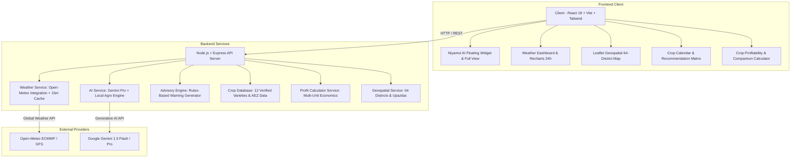

# 🌾 Abhawa Bondhu (আবহাওয়া বন্ধু) — Smart Bangladesh Weather & Agriculture Platform

[](https://reactjs.org/)
[](https://www.typescriptlang.org/)
[](https://vitejs.dev/)
[](https://nodejs.org/)
[](https://expressjs.com/)
[](https://tailwindcss.com/)
[](https://ai.google.dev/)
[](https://opensource.org/licenses/MIT)

> **"Empowering Bangladesh’s Farmers with Precision Meteorological Intelligence, Actionable Agronomic Guidance, and Financial Clarity."**

---

## 📌 Executive Summary

**Abhawa Bondhu (আবহাওয়া বন্ধু)** is an end-to-end, production-grade Agro-Meteorological & Financial Intelligence Platform tailored specifically for the 64 districts and 8 administrative divisions of Bangladesh. 

Built with a **mobile-first, rural-friendly philosophy**, the platform bridges the digital divide for ordinary citizens and smallholder farmers by transforming complex satellite, numerical weather prediction (ECMWF/GFS), and agronomic research data (BRRI, BARI, BJRI, DAE) into intuitive, high-contrast, actionable guidance.

The platform integrates **Niyamul AI**, an intelligent agro-meteorological consultant that dynamically ingests live localized weather data and provides instant, scientifically grounded advisory on crop management, pest mitigation, and weather-driven farming decisions.

---

## ✨ Key Capabilities & System Features

### 1. 🤖 Niyamul AI — Smart 24/7 Agro-Meteorological Consultant
* **Live Weather Context Awareness:** Automatically fetches and incorporates current local temperature, humidity, wind velocity, and rainfall forecasts into every recommendation.
* **Dual-Engine Redundancy Architecture:** Seamlessly toggles between Google Gemini AI Pro and an internal, zero-dependency Bangladesh Agricultural Knowledge Engine—guaranteeing 100% advisory uptime even during connectivity or API quota limits.
* **Persistent Floating Assistant & Mobile Bottom-Bar:** Instantly accessible across all devices with one tap.
* **Curated Farmer Query Chips:** Pre-built prompts covering fertilizer scheduling, pre-monsoon pesticide timing, late blight mitigation, and heat-shock protection.
* **One-Click Markdown Copy & Formatting:** Clear, structured advice optimized for rapid reading and field sharing.

### 2. 🌦️ Precision Weather Engine & 7-Day Agronomic Forecast
* **Real-Time Satellite & Numerical Data:** Integrated with Open-Meteo API pulling global ECMWF and GFS ensembles, cached with a 15-minute in-memory TTL to eliminate rate bottlenecks.
* **Natural Language WMO Weather Synthesis:** Direct conversion of WMO weather codes into plain-language Bengali and English explanations.
* **Interactive 24-Hour Timeline:** Temperature trends, rain probabilities, and humidity curves visualized with Recharts.
* **Agronomic Feasibility Scoring:** Contextual suitability metrics for grain drying, spraying, weeding, harvesting, and irrigation scheduling.
* **General Citizen Lifestyle Cards:** Actionable guidance for daily commutes, umbrellas, outdoor labor, and laundry drying.

### 3. 🗺️ Interactive Geospatial Bangladesh Map Explorer
* **Complete Administrative Geo-Catalog:** Accurate latitude, longitude, division, and Agro-Ecological Zone (AEZ) data for all 64 districts and upazilas.
* **Leaflet & OpenStreetMap Visualization:** Smooth panning, zooming, and interactive district pins displaying live climatic snapshots.
* **Reverse Geocoding on Map Click:** Click anywhere on the map of Bangladesh to automatically detect the nearest meteorological grid and query real-time forecasts.
* **Browser Geolocation:** Instant GPS location detection with one-touch browser consent.

### 4. 🌾 Agronomic Crop Calendar & Variety Database
* **12 Major Bangladesh Staples & Cash Crops:**
  * **Rice:** Boro (*BRRI dhan29, BRRI dhan89, Banglamati*), Ropa Aman (*BRRI dhan49, BRRI dhan87*), Aus (*BRRI dhan48*).
  * **Cereals & Tubers:** Wheat (*BARI Gom-33 blast-resistant*), Maize (*BARI Hybrid-9*), Potato (*Diamant, Cardinal, Asterix*).
  * **Cash Crops, Pulses & Oilseeds:** Jute (*BJRI Tosha-8*), Mustard (*BARI Sarisha-14/18*), Lentils (*BARI Masur-8*), Onion, Green Chilli, Coastal Watermelon.
* **Dynamic Sowing Windows:** Automatically classifies crops into *Active Sowing*, *Upcoming Season*, or *Past Window* based on the Bengali agro-calendar (Baishakh to Chaitra / Jan–Dec).
* **Disease & Risk Management Profiles:** In-depth countermeasures for late blight, rice blast, cold injury, heat shock, and soil salinity.

### 5. 💰 Crop Budgeting & Agricultural Profitability Planner
* **Mathematical Formula Transparency:**
  $$\text{Gross Revenue} = \text{Expected Yield (kg)} \times \text{Selling Price per kg}$$
  $$\text{Net Profit} = \text{Gross Revenue} - \text{Total Production Cost}$$
* **Local Land Measurement Units:** Native support for Decimal (শতাংশ), Bigha (৩৩ শতাংশ), and Acre (১০০ শতাংশ).
* **Itemized Cost Modeling:** Editable inputs for seeds/seedlings, fertilizers (Urea, TSP, MoP), crop protection chemicals, manual labor, irrigation/fuel, plowing, and transport.
* **Break-Even Analysis:** Automatic calculation of the minimum selling price per kg and per maund (৪০ কেজি) required to avoid loss.
* **Side-by-Side Crop Comparison:** Simultaneously compare economic outcomes of multiple crops on the identical parcel of land to maximize ROI.

### 6. 🚨 Rules-Based Farming Early Warning System
* **Automated Meteorological Trigger Logic:**
  * **Severe Nor'wester & Lightning:** Urgent life-safety and livestock sheltering alerts.
  * **Heavy Precipitation & Waterlogging:** Warnings against fertilizer leaching and pesticide spray washouts.
  * **Extreme Heat Stress & Heat Shock:** Critical irrigation advisories during rice anthesis and flowering stages.
  * **Fog & Persistent Moisture:** Early fungicide warning for potato late blight and wheat blast.
  * **Optimal Harvest Window:** Clear notifications for safe harvesting, threshing, and sun-drying.

### 7. 💎 Ultra-High Readability & Universal Accessibility
* **Bilingual Switch:** Instant toggling between native Bengali (বাংলা) and English.
* **Tailored Bengali Typography:** Loaded with Google Fonts `Hind Siliguri` and `Noto Sans Bengali` for crisp rendering across entry-level Android devices.
* **Ultra-Bold Tabular Numerals:** Temperature values displayed in massive `text-7xl` to `text-9xl font-black`, and monetary figures in `text-4xl` to `text-5xl` high-contrast tabular figures (`৳`) for effortless field legibility.

---

## 🏛️ System Architecture



---

## 🛠️ Technology Stack

| Layer | Technologies |
|---|---|
| **Frontend Framework** | React 18, Vite 5, TypeScript |
| **Styling & Design System** | Tailwind CSS 3.4, PostCSS, Lucide React Icons |
| **Data Visualization** | Recharts (Responsive 24h temperature & precipitation curves) |
| **Geospatial & Mapping** | Leaflet, React-Leaflet, OpenStreetMap Tiles |
| **Typography** | Hind Siliguri, Noto Sans Bengali, Outfit, Inter |
| **Backend Framework** | Node.js 22, Express.js 4, TypeScript via `tsx` |
| **AI & LLM Services** | Google Gemini API (1.5 Flash/Pro) + Fallback Agronomic Rule Engine |
| **Performance & Caching** | In-Memory TTL Cache (`node-cache`) |
| **External Weather API** | Open-Meteo Weather Forecast API (ECMWF & GFS global models) |

---

## 📡 REST API Reference

| Method | Endpoint | Description |
|---|---|---|
| `GET` | `/api/health` | System health check, uptime, and metadata |
| `GET` | `/api/locations/divisions` | Retrieve all 8 administrative divisions of Bangladesh |
| `GET` | `/api/locations/districts` | Full catalog of 64 districts with coordinates and AEZ zones |
| `GET` | `/api/locations/upazilas?districtId={id}` | List upazilas for a given district |
| `GET` | `/api/locations/search?q={query}` | Global search across divisions, districts, and upazilas |
| `GET` | `/api/locations/reverse?lat={lat}&lon={lon}` | Nearest district and upazila lookup from GPS coordinates |
| `GET` | `/api/weather?lat={lat}&lon={lon}` | Real-time weather, 24-hour hourly curve, and 7-day forecast |
| `GET` | `/api/crops` | Retrieve verified database of 12 agricultural crops |
| `GET` | `/api/crops/recommendations?districtId={id}&month={m}` | Agro-ecological zone & month-based crop suitability scoring |
| `POST` | `/api/profitability/calculate` | Compute input costs, yield value, break-even price, and net profit |
| `POST` | `/api/profitability/compare` | Multi-crop comparative economic analysis for a given land parcel |
| `POST` | `/api/ai/chat` | **Niyamul AI** context-aware agronomic and weather chat endpoint |
| `GET` | `/api/advisories/active?lat={lat}&lon={lon}` | Meteorological rules-based active farming alerts |
| `GET` | `/api/admin/stats` | Server operational metrics, dataset counts, and cache status |

---

## 🚀 Getting Started

### Prerequisites
* **Node.js**: v18.x or higher (v22.x recommended)
* **npm**: v9.x or higher

### 1. Clone the Repository
```bash
git clone https://github.com/Niyamul-04/smart-farmer.git
cd smart-farmer
```

### 2. Install Dependencies
```bash
# Install root, server, and client dependencies concurrently
npm run install:all
```
*Or install separately:*
```bash
cd server && npm install
cd ../client && npm install
cd ..
```

### 3. Configure Environment Variables (Optional)
Copy the example environment file:
```bash
cp .env.example .env
```
To enable Google Gemini AI generation in Niyamul AI, add your API key in `server/.env`:
```env
PORT=5000
NODE_ENV=development
GEMINI_API_KEY=your_gemini_api_key_here
```
*(Note: If no API key is provided, Niyamul AI automatically falls back to the embedded Agricultural Rule Engine seamlessly).*

### 4. Run the Development Environment
Start the backend server (Port 5000):
```bash
cd server
npm run dev
```

In a separate terminal, launch the frontend client (Port 3000):
```bash
cd client
npm run dev
```

Open your browser and navigate to:
```
http://localhost:3000
```

### 5. Production Build
```bash
# Build the React client bundle
cd client
npm run build
```

---

## 🌾 Data Governance & Institutional Acknowledgements

1. **Weather Forecasting Data:** Powered by [Open-Meteo](https://open-meteo.com/) under Creative Commons Attribution 4.0 International (CC BY 4.0) using global models from ECMWF and GFS.
2. **Agronomic Data Benchmarks:** Crop growth periods, recommended varieties, and management practices are synthesized from official publications of:
   * **BRRI** (Bangladesh Rice Research Institute)
   * **BARI** (Bangladesh Agricultural Research Institute)
   * **BJRI** (Bangladesh Jute Research Institute)
   * **DAE** (Department of Agricultural Extension)
   * **BMD** (Bangladesh Meteorological Department)
3. **Emergency Weather Disclaimers:** In events of severe cyclones, tidal surges, or sudden flash floods, citizens and farmers are advised to cross-reference official warnings broadcast by the Bangladesh Meteorological Department and the Ministry of Disaster Management and Relief.

---

## 👨‍💻 Project Lead & Author

* **Developer:** **Niyamul Hasan**
* **GitHub:** [@Niyamul-04](https://github.com/Niyamul-04)
* **Email:** niyamulhasan301@gmail.com
* **Repository:** [https://github.com/Niyamul-04/smart-farmer](https://github.com/Niyamul-04/smart-farmer)

---

## 📄 License

This project is licensed under the **MIT License** — see the [LICENSE](LICENSE) file for details.
